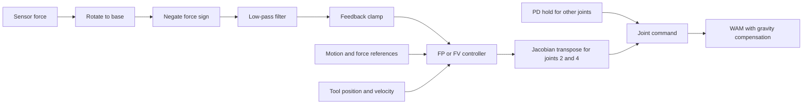

# Hybrid Contact Control for Barrett WAM

This research project implements hybrid force/motion control on a Barrett WAM
using libbarrett. The main experiments combine motion along base x with contact
force regulation along base z. The F/T variants use a physical force/torque
sensor and command joint torques through a Jacobian-transpose mapping.

| Executable | Motion feedback | Force source | Source |
|---|---|---|---|
| `hybrid_fp_ft` | Cartesian position with velocity damping | Barrett F/T sensor | [FP application](src/hybrid_fp_ft.cpp) |
| `hybrid_fv_ft` | Cartesian velocity with optional error derivative | Barrett F/T sensor | [FV application](src/hybrid_fv_ft.cpp) |
| `hybrid_control` | Original task-frame force/velocity implementation | Estimated external wrench from joint torque signals | [Original application](src/hybrid_control.cpp) |

The descriptions and commands below apply to **FP and FV** unless stated
otherwise. The original controller retains its own task-frame transforms,
headers, references, and logging. The former `hybrid_control_ft` executable was
renamed to `hybrid_fv_ft`; an old build directory may still contain its obsolete
binary.

## Build and run

Dependencies include a C++14 compiler, CMake, libbarrett and its dependencies
(including Eigen and libconfig++), Curses, and Boost system/iostreams. Running the
controllers requires a configured WAM and a detected Barrett F/T sensor.
Python plotting requires Python 3 and matplotlib.

From the repository root:

```bash
cmake -S . -B build -DCONTACT_CONTROL_BUILD_TESTS=ON
cmake --build build -j2
ctest --test-dir build --output-on-failure
```

Run one controller from `build/` so the supplied log directory resolves to
the corresponding repository data subdirectory:

```bash
cd build
./bin/hybrid_fp_ft
# Or: ./bin/hybrid_fv_ft
```

Use the appropriate robot configuration/calibration for the hardware.
`BARRETT_CONFIG_FILE` selects the robot configuration; it is separate from the
controller tuning file. Example configuration trees are under
[config/slax](config/slax) and [config/zeus](config/zeus).

Controller tuning is loaded once at startup from
[hybrid_fp_ft.conf](config/hybrid_fp_ft.conf) or
[hybrid_fv_ft.conf](config/hybrid_fv_ft.conf). The compiled default points to this
checkout. To override it, set the matching environment variable before running:

```bash
export HYBRID_FP_FT_CONFIG=/absolute/path/to/hybrid_fp_ft.conf
export HYBRID_FV_FT_CONFIG=/absolute/path/to/hybrid_fv_ft.conf
```

Restart after changing a configuration; rebuilding is unnecessary. The program
prints the selected tuning path and pattern and rejects invalid required values.
The configuration files are experiment settings, not universal validated gains.
Numerical examples in this README do not override those files.

## Coordinate frames and signs

| Frame | Meaning |
|---|---|
| Sensor | Axes in which the F/T sensor reports force |
| Tool | Tool frame defined by the selected robot kinematics |
| Base | Fixed robot-base axes used for the F/T control task |
| World | libbarrett kinematic reference frame |

The implementation assumes **sensor axes align with tool axes**. It reads
`tool->rot_to_world` and multiplies the sensor force by that matrix. This is a
tool-to-world rotation, not its transpose. Calling the result “base force” assumes
that the robot's `world_to_base` transform is identity. A nonidentity robot
configuration requires reviewing the frame conversion and reference definitions.

Let `R` map tool/sensor coordinates into world/base coordinates. The sensor
convention is **environment-on-robot**:

```text
F_env_base = R * F_sensor
F_robot_base = -F_env_base
```

The negative sign converts the measurement into **robot-on-environment**, the
convention used by desired force and controller feedback. For example, a desired
base-z force of -5 N means the robot pushes toward base -z; the environment's
reaction is toward base +z.

| Signal | Coordinates | Force convention / processing |
|---|---|---|
| Console `sensorForce` | Sensor | Environment on robot, sensor reading after any tare |
| Console `baseForce` | Base under the identity assumption | Environment on robot, rotated only |
| CSV `fsensor_*` | Sensor | Same convention as `sensorForce` |
| CSV `fcur_*` | Base | Robot on environment, unfiltered and unclamped |
| CSV `ffiltered_*` | Base | Robot on environment, low-pass filtered, before clamp |
| Controller force feedback | Base | Robot on environment, filtered and clamped |
| Desired force, position, velocity | Base | Force uses robot-on-environment convention |

The controller uses only the three force components; measured moments are unused.
There is no extra sensor mounting rotation, payload compensation, or contact-frame
estimation. Base x/z remain the task axes as the tool moves. Holding the other
joints does not guarantee a fixed tool orientation.

## Signal flow and implementation



The applications construct libbarrett `System` objects, connect typed inputs and
outputs, and let the execution manager evaluate their `operate()` methods.
Kinematics supply Cartesian position, velocity, tool rotation, and the tool
Jacobian. Controller integration and filtering use the execution-manager period;
trajectory references use elapsed `steady_clock` time. The control period comes
from the robot runtime, not from the trajectory duration or logging settings.

| Location | Responsibility |
|---|---|
| [src/hybrid_fp_ft.cpp](src/hybrid_fp_ft.cpp), [src/hybrid_fv_ft.cpp](src/hybrid_fv_ft.cpp) | Configuration, signal wiring, command handling, and logger lifecycle |
| [include/hybrid_ft](include/hybrid_ft) | Shared sensor acquisition, frame conversion, configuration loader, filter, clamp, Jacobian, joint torques, constant reference, and CSV logger |
| [FP controller](include/hybrid_fp_ft/controller.hpp) | Position PD plus force PI/feedforward |
| [FP reference](include/hybrid_fp_ft/position_reference.hpp) | One-way position move or ramped position sine |
| [FV controller](include/hybrid_fv_ft/controller.hpp) | Velocity PD plus force PI/feedforward |
| [FV reference](include/hybrid_fv_ft/velocity_reference.hpp) | Sine velocity or finite move velocity; integrated position for diagnostics |
| [include/hybrid_control](include/hybrid_control) | Original estimated-wrench/task-frame implementation |
| [tests](tests) | Hardware-free control-law, reference, filter, configuration, and torque-mapping checks |
| [scripts](scripts) | Plotting and hardware setup utilities |

## Control design

All Cartesian gains are diagonal. Define:

```text
S  = diag(motion_axes)
Sf = I - S
ef = Fdesired - Ffeedback
If[k] = clamp(If[k-1] + Sf * ef[k] * dt, +/-force_integral_limit)
uf = Sf * (force_feedforward_gain * Fdesired + Kf * ef + Ki * If)
```

`motion_axes = [1, 0, 0]` selects motion control on x and force control on y/z.
With zero y-force target and gains, y contributes no command. FP requires this
selection; FV accepts binary axis selections. In FV, choose `velocity_axis` on a
motion-selected axis for the reference to contribute to the controller output.

### Force/position (FP)

```text
ep = pdesired - pmeasured
ev = vdesired - vmeasured
u  = S * (Kp_position * ep + Kd_position * ev) + uf
```

`vdesired` is the analytic derivative of the position reference, including the
sine startup envelope. Position gains have units N/m; damping gains have units
N*s/m. FP corrects position error during the move and continues correcting x
error at the final endpoint. There is no position integral term, so a sustained
load can leave a position offset.

### Force/velocity (FV)

```text
ev = vdesired - vmeasured
ev_dot[k] = (ev[k] - ev[k-1]) / dt
u = S * (Kp_velocity * ev + Kd_velocity * ev_dot) + uf
```

The first derivative sample after reset is zero. The derivative is a finite
difference of velocity error, not the FP position controller's velocity damping.
Velocity proportional gains have units N*s/m; derivative gains have units
N*s^2/m. FV logs a desired position for comparison, but position does not enter
its feedback law. A finite velocity reference therefore does not guarantee the
specified physical displacement or restore an absolute endpoint after drift.

### Joint torque mapping

`u` is a three-component Cartesian force-like command. Let `Jv` be the first
three rows of the tool Jacobian. Only joints **2 and 4** receive its transpose
mapping (zero-based indices 1 and 3):

```text
tau[i] = Jv[:, i]^T * u                         for joints 2 and 4
tau[i] = hold_kp[i]*(q_hold[i]-q[i]) - hold_kd[i]*qdot[i]  otherwise
```

The held pose is captured whenever contact control starts. By default, hold gains
come from `wam.jpController`; `use_robot_hold_gains = false` selects the explicit
configuration arrays. Gravity compensation remains enabled through the WAM's
separate gravity contribution.

This is a joint-torque hybrid controller, not a Cartesian inverse-dynamics or
operational-space decoupling controller. Selecting different force/motion axes
does not remove physical coupling through robot dynamics, friction, contact
geometry, or changing tool orientation. Two active joints do not provide general
six-degree-of-freedom pose control.

## Motion patterns

For a duration `D`, define `s = clamp(t/D, 0, 1)` and the quintic profile:

```text
h(s) = 10*s^3 - 15*s^4 + 6*s^5
h_dot = 30*s^2*(1-s)^2 / D
```

It begins and ends with zero reference velocity and acceleration.

| Controller / pattern | Settings | Behavior |
|---|---|---|
| FP `move` | `position_distance`, `position_duration` | Smooth move to target-origin x plus signed distance, then hold reference |
| FP `sine` | `position_amplitude`, `position_period`, `position_duration` | Oscillate around target-origin x; duration controls startup envelope |
| FV `move` | `velocity_distance`, `velocity_duration`, `velocity_axis` | Smooth finite velocity pulse, then zero desired velocity |
| FV `sine` | `velocity_peak`, `velocity_period`, `velocity_axis` | Continuous sinusoidal velocity |

### FP references

`t` captures the Cartesian target origin `x0`. Each activation `c` captures the
actual starting position `xs` and restarts time.

For `position_pattern = "move"`:

```text
xgoal = x0 + position_distance
xdesired(t) = xs + h(t/D)*(xgoal-xs)
vdesired(t) = h_dot(t/D)*(xgoal-xs)
```

`D = position_duration`. Restarting `c` after stopping moves from the current
position toward the same endpoint, rather than adding another full distance.
Only x is position-controlled; z remains force-controlled.

For `position_pattern = "sine"`, let `A = position_amplitude`,
`omega = 2*pi/position_period`, and `b = h(t/position_duration)`:

```text
xdesired = xs + b*(x0-xs + A*sin(omega*t))
vdesired = b_dot*(x0-xs + A*sin(omega*t)) + b*A*omega*cos(omega*t)
```

After the startup envelope, the reference is `x0 + A*sin(omega*t)`. Amplitude is
one-sided: 0.05 m means +/-5 cm, or 10 cm peak-to-peak. `position_distance` is
unused in sine mode. A sine reaches its positive peak at period/4; choosing a
period four times the ramp duration makes the first full-amplitude peak coincide
with ramp completion. Intermediate motion still differs from a one-way move.

### FV references

For `velocity_pattern = "move"`, with signed distance `L` and duration `D`:

```text
vdesired(t) = (L/D)*30*s^2*(1-s)^2     for 0 < t < D
vdesired(t) = 0                       otherwise
```

The integral is `L`; peak speed is `1.875*abs(L)/D`. For example, a 0.10 m command
over 6 seconds peaks at 0.03125 m/s. `velocity_peak` is unused in this mode.
Every new activation starts another full pulse relative to the current pose.

For `velocity_pattern = "sine"`:

```text
vdesired(t) = velocity_peak*sin(omega*t)
omega = 2*pi/velocity_period
pdesired_axis(t) = pstart_axis + velocity_peak/omega*(1-cos(omega*t))
```

This integrated position oscillates between the starting position and a positive
offset of `2*velocity_peak/omega`; it is not the FP sine centered on the target.
The logged integrated reference is calculated analytically for both patterns.

## Force filtering, limits, and tare

The shared first-order low-pass uses:

```text
alpha = 1 - exp(-2*pi*force_filter_cutoff_hz*dt)
Ffiltered[k] = Ffiltered[k-1] + alpha*(Fraw[k]-Ffiltered[k-1])
```

The filter initializes to its first reading and resets after target-pose tare.
A cutoff of `0` bypasses filtering; a missing setting in an older configuration
also defaults to bypass. Lower cutoffs smooth more but add feedback delay.
Nonfinite force components are replaced with zero in the filtering/clamping path.

`force_feedback_limit` clips the filtered feedback per axis before error
calculation. It does **not** limit physical contact force or the Cartesian/joint
torque command. The integral bound is in N*s; maximum integral contribution on
an axis is `force_ki[axis] * force_integral_limit`. This is integral clamping,
not back-calculation from actuator saturation. Increasing Ki changes both the
correction rate and that maximum contribution.

`t` calls the sensor's native `tare()` after the blocking joint move completes,
under the execution-manager mutex. Any load present at that pose becomes part of
the baseline. No extra settling delay, tare verification, or orientation-dependent
payload compensation is implemented. Force references are constant; there is no
force-reference ramp at contact activation. A filter can attenuate a recorded
spike without eliminating its physical cause.

## Interactive operation

| Command | Action |
|---|---|
| `t` | Stop active contact/logging, move to `target_position`, tare F/T, reset force filter; FP also captures target origin |
| `c` | Start contact control and a new CSV, reset controller/reference state, capture held-joint pose |
| `x` | Disconnect contact control and close the CSV; does not command a Cartesian position hold |
| Enter | Stop contact if active and move home; invalidate FP target origin |
| `q` | Stop active contact logging/control and exit the command loop; no explicit home move in this branch |

FP refuses `c` until `t` has established an origin. FV has no such prerequisite
check, so use `t` then `c` for the intended target-and-tare workflow. Pressing `c`
while already active does not restart the trajectory. Reaching a reference's
end time does not automatically stop the controller or close the log.

## Configuration reference

| Settings | Purpose |
|---|---|
| `motion_axes` | Binary selection: 1 motion, 0 force, in base XYZ order |
| `position_kp`, `position_kd` | FP position and velocity-error gains |
| `velocity_kp`, `velocity_kd` | FV velocity-error and error-derivative gains |
| `force_kp`, `force_ki`, `force_feedforward_gain` | Force feedback and feedforward |
| `force_integral_limit` | Positive per-axis bound on accumulated force error |
| `desired_force` | Base-frame robot-on-environment force target in N |
| `force_filter_cutoff_hz`, `force_feedback_limit` | Low-pass cutoff and feedback clipping |
| `position_pattern`, `velocity_pattern` | `move` or `sine` for the corresponding executable |
| Pattern parameters above | Distances/amplitudes in m, velocities in m/s, durations/periods in s |
| `target_position` | Seven joint angles in radians; four-DOF robots use first four |
| `use_robot_hold_gains`, `hold_kp`, `hold_kd` | PD gains for joints outside the Cartesian task |
| `log_period_multiplier` | Record every N execution cycles |
| `log_directory` | Output directory, relative to process working directory if not absolute |

The source of truth for a run is the tuning file loaded at startup. CSVs do not
currently embed the gains, cutoff, selected robot configuration, or a complete
configuration snapshot; preserve those separately when comparing experiments.

## CSV data and plots

Each contact activation creates the next numbered file in its controller's
data subdirectory (`data/hybrid_fp_ft` or `data/hybrid_fv_ft`):
`hybrid_fp_ft_datalog_NNNN.csv` or `hybrid_fv_ft_datalog_NNNN.csv`. Historical
`hybrid_base_ft_datalog_*` files are kept in `data/hybrid_base_ft`, retain
their old names, and may lack newer columns. Hybrid task logs are written to
`data/hybrid_task`.

| Columns | Meaning |
|---|---|
| `vdes_x/y/z`, `vcur_x/y/z` | Desired and measured Cartesian velocity, m/s |
| `fdes_x/y/z`, `fcur_x/y/z` | Desired and raw sign-corrected base force, N |
| `time_s` | Steady-clock elapsed seconds from the first logged sample; resets per file |
| `fsensor_x/y/z` | Sensor-frame force after any tare, environment-on-robot, N |
| `q1` through `qN` | Measured joint angles, rad |
| `R_world_tool_00` through `R_world_tool_22` | Row-major tool-to-world rotation used in force conversion |
| `pdes_x/y/z`, `pcur_x/y/z` | Desired and measured Cartesian position, m; FV desired position is diagnostic only |
| `ffiltered_x/y/z` | Filtered base force before feedback clamping, N |

For the logged raw signals, `fcur = -R_world_tool * fsensor`. The actual force
feedback is `clamp(ffiltered, +/-force_feedback_limit)`, so raw `fcur` can exceed
the configured clamp. CSV time starts at first logging, not necessarily the exact
reference start instant. The logger writes CSV rows directly from its system's
execution callback; this is not an asynchronous buffered logging service.

From the repository root, substituting an existing run number:

```bash
python3 scripts/plot_hybrid_fp_ft_csv.py data/hybrid_fp_ft/hybrid_fp_ft_datalog_0001.csv
python3 scripts/plot_hybrid_fv_ft_csv.py data/hybrid_fv_ft/hybrid_fv_ft_datalog_0001.csv
```

FP plots x position and z force. FV plots x position, x velocity, and z force;
older logs without positions fall back to velocity/force panels. Both overlay
filtered z force when available. To save without a window:

```bash
python3 scripts/plot_hybrid_fp_ft_csv.py data/hybrid_fp_ft/hybrid_fp_ft_datalog_0001.csv --save fp_plot.png --no-show
```

The older `plot_hybrid_task_csv.py` supports original task-controller logs.

## Verification and practical limits

The hardware-free tests cover the FP control law, quintic/sine references,
finite FV displacement integral, low-pass response/reset/bypass, configuration
loading, and planar joint-torque mapping. They do not establish closed-loop
stability, physical sensor alignment, contact behavior, or suitable gains for a
particular tool and surface.

Position/velocity and force channels can interact during sliding even when
force-only regulation performs well. Tare, filtering, and increasing gains do not
supply payload compensation or dynamic decoupling. The implementation has no
Cartesian output saturation or contact-force shutdown in these controller
classes; feedback clipping must not be interpreted as either. Robot-level
protections are configured separately through libbarrett and the hardware.
